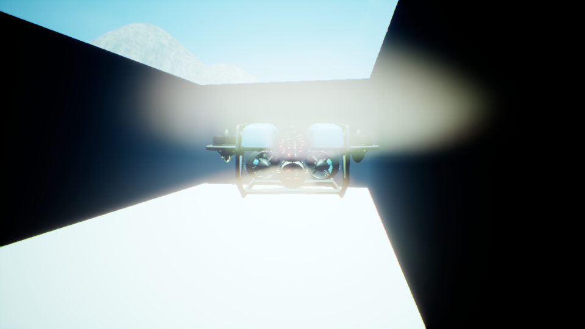
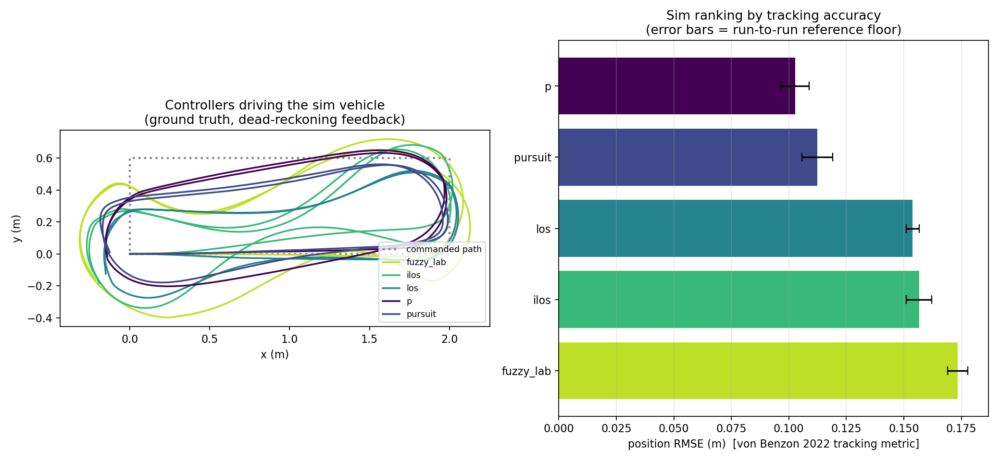

# Holo-for-CACMS: Can You Trust a Simulator's Controller Rankings? A Validated BlueROV2 Digital Twin

A digital twin of a BlueROV2 underwater robot in [HoloOcean](https://byu-holoocean.github.io/holoocean-docs/),
built to answer one question with evidence instead of hope: **if the simulator says
controller A beats controller B, does that hold on the real vehicle?** Everything in
this repo exists to make that comparison trustworthy — a statistically validated twin,
a calibrated pass/fail methodology, a controller benchmark, the kit that drives the
real vehicle, and pre-registered predictions checked against real pool sessions.





## The three claims, and where they stand

**1. The twin's data is statistically indistinguishable from real recordings.**
38 of 41 calibrated checks pass when sim and real are compared on the same maneuvers
in the same pool (the three misses are marginal and diagnosed). The pass criterion is
itself validated: it admits 95% of genuine real recordings by construction, after we
showed the textbook approach wrongly rejects 18% of real data.

**2. The twin predicts controller behavior — including failure.**
In its first real test (Oct 2026), five path-following controllers drove the real
vehicle. The twin had ranked the lab's fuzzy tracker last — it tracked worst in
reality and crossed the pool's 1.0 m safety boundary. The twin's excursion prediction
for that controller: **1.02 m, the only law over the line; reality: 1.03 m.** That
prediction is now pre-registered for the confirmatory session.

**3. The ranking comparison is tamper-proof.**
The sim's predicted ranking, the analysis statistics (pairwise-separable ordering +
MMRV, Spearman secondary), and the interpretation rule — including what we say if the
result is inconclusive — are frozen publicly in
[docs/preregistration.md](docs/preregistration.md) *before* the confirmatory session,
against a fixed commit. Amendments are append-only and disclosed.

Status: shakedown session complete (all 5 controllers ran; preliminary agreement
underpowered by design); confirmatory session (5 laws × 4 repeats + line course) is
the next milestone. The one known disagreement candidate (pursuit vs ILOS) localizes
to unmodeled tether drag — by design, the methodology names its own blind spots.

## Use this with your own vehicle

The methodology is vehicle-agnostic; the BlueROV2 parts are swappable. The recipe:

1. **Record** your vehicle: a motors-off float, a motors-on hover, and short
   single-axis runs (surge / sway / heave / yaw at 2–3 throttle levels).
2. **Fit** sensor noise (float decomposition) and per-axis dynamics (steady-state
   windows) — `sim/tubtest_floats.py`, `sim/tub_sysid.py`.
3. **Score** your sim's realism against your recordings with the calibrated
   scorecard — `sim/fidelity_scorecard.py` + `sim/threshold_study.py`. These compare
   npz sensor streams; they do not care what vehicle produced them.
4. **Pre-register and test**: freeze your sim's controller ranking
   (template: `docs/preregistration.md`), run the real session
   (`docs/real_ranking_protocol.md`), compare with `sim/score_correlation.py`.

| Layer | Vehicle-agnostic (keep) | BlueROV2-specific (swap) |
|---|---|---|
| Fidelity | `fidelity_scorecard.py`, `threshold_study.py`, `method_selection_study.py`, `tubtest_floats.py` | — |
| Ranking | `score_ranking.py`, `score_correlation.py`, `power_analysis.py`, pre-registration + protocol templates | course dimensions |
| Twin | servo/replay architecture in `mavros_bridge.py` | `bluerov2_standard_model.py`, `scenario_bluerov.json`, topic names, `intex_pool.py` |
| Real vehicle | `real/tracker.py` laws, `real/course_runner.py` | `real/cmdvel_to_manual.py` stick gains, MAVLink specifics |

(Demonstrated end-to-end on one platform; the generic layer makes no BlueROV2
assumptions, but porting it to your vehicle is your validation to run, not ours to claim.)

## What's in the repo

```
sim/     the twin + analysis: sensor bridge, dynamics model, pool, fidelity scorecard,
         criterion calibration, benchmark + ranking/correlation statistics
real/    drives the actual vehicle: 5 path-following laws (shared with sim),
         /cmd_vel -> MAVLink stick converter with safety keys, course runner,
         session scoring, LLM camera-pilot, offline fake-backend tests
tools/   bag -> npz conversion, replay, recorders, noise fitting
scripts/ one-command E2E suites (verify, benchmark, fidelity campaign)
docs/    pre-registration · real-session protocol · validation report (PDF)
```

Run instructions: [INSTRUCTIONS.md](INSTRUCTIONS.md) (sim workflows) and
[real/CONTROLLER_RUN_INSTRUCTIONS.md](real/CONTROLLER_RUN_INSTRUCTIONS.md) (pool
sessions, written for the topside operator).

## Validation summary

| Part | How it was matched | Result |
|---|---|---|
| Sensor data | formats/rates/frames from real recordings; noise decomposed via armed/disarmed floats; stream quirks replicated (DVL duplicate stream, accel sample-and-hold) | field-for-field identical; 38/41 statistical checks |
| Dynamics | per-axis steady-state fit from single-axis runs; axis conventions recovered from data | surge ±16%, heave ±24%, sway/yaw re-fit from measurement |
| Pool | Intex 26770 manual + capacity: 4.0×2.0 m, 1.05 m water | exact; 100% containment in autonomous laps |
| End to end | lab dead-reckoning runs unchanged | drift 3–5% of distance, matching real data |
| Behavior | controller ranking + excursion predictions vs real sessions | fuzzy ranked last + fence breach predicted (1.02 m vs 1.03 m real); confirmatory session pre-registered |

Full write-up: [docs/BlueROV2_Simulation_Report.pdf](docs/BlueROV2_Simulation_Report.pdf)

## Setup (once)

Requirements: Linux with a GPU, ROS 2 (Humble or newer), and a GitHub account linked
to Epic Games (HoloOcean's install requires it).

```bash
python3 -m venv --system-site-packages ~/holoocean-env
git clone https://github.com/byu-holoocean/HoloOcean.git ~/holoocean
~/holoocean-env/bin/pip install ~/holoocean/client
~/holoocean-env/bin/python -c "import holoocean; holoocean.install('Ocean')"
git clone https://github.com/ChideraIbe123/Holo-for-CACMS.git
```

Quick start: `~/holoocean-env/bin/python sim/mavros_bridge.py --headless --move --pool intex`
(real-format sensor topics from a vehicle swimming the pool twin).

## Conventions & gotchas (read before touching the bridge)

- HoloOcean's IMU gravity is sign-flipped vs a real IMU; the bridge corrects it.
- The acceleration control scheme is engine index 2 (the python docs list it wrong).
- The real vehicle's angular rates and DVL wire format are FRD vs ROS's FLU (x same,
  y/z inverted) — confirmed empirically and in the lab's EKF source. The bridge
  publishes the RAW wire convention, including the −1.848° DVL mount yaw + lever arm.
- Yaw command convention is inverted (MAVLink CW+ vs ROS CCW+): controllers run
  `--yaw-sign -1`; this vehicle's motor directions live in ESC config, so logged PWMs
  are direction-less.
- True sensor noise is tiny; in-mission "noise" is mostly motion/disturbance — the
  bridge injects sensor floors when idle, excitation-dependent disturbance when
  driving, and trajectory-matches rotation/heave during replays.
- The physics engine sleeps slow bodies; pool scripts carry a teleport watchdog.
- ONE bridge at a time; run campaigns detached; every change is judged by a rerun
  campaign and the scorecard, never by eye. Constants carry their provenance in
  comments.

## Citing

See [CITATION.cff](CITATION.cff) (release v1.0.0, MIT license — the LICENSE file
states the HoloOcean/Unreal dependency boundary).

## Sources

HoloOcean (BYU) · von Benzon et al. 2022 JMSE (benchmark metrics, SMC, T200) ·
Wu 2018 (6-DOF coefficients) · Kadian et al. RA-L 2020 + Li et al. 2024 SIMPLER
(ranking-validation lineage) · Fossen 2021 / Børhaug 2008 (LOS/ILOS laws) ·
clydemcqueen/bluerov2_gz (thruster geometry) · AUVSL BlueROV-Tools (deployed EKF
conventions, transforms, static noise notes)
